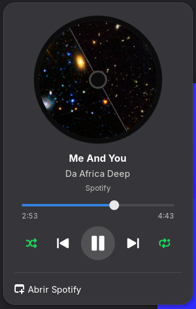
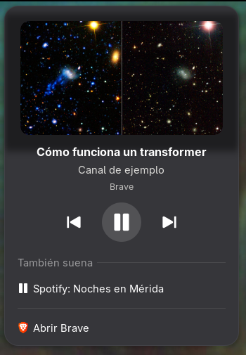

# Disco

Extensión de GNOME que pone en la barra de arriba la portada de lo que está sonando.


| Música: gira como disco | Video: miniatura, con «También suena» |
|---|---|
|  |  |

*Canción, artista y video son de ejemplo.*

- **Música** (Spotify, YouTube Music, SoundCloud, Rhythmbox, Amberol…): la portada se ve como un
  disco de vinil y **gira mientras suena**. En pausa se detiene.
- **Videos** (YouTube, Netflix, cualquier video en Brave o Firefox): la portada se ve como una
  miniatura quieta.
- **Al picarle:** portada grande, canción, artista, una **barra para adelantar o atrasar** (arrastrándola,
  con clic, con la rueda del ratón o con las flechas del teclado) con el tiempo que va y el total, y
  los botones de **aleatorio, anterior, pausa, siguiente y repetir** (repetir cambia entre apagado,
  toda la lista y solo esta canción). Aleatorio y repetir se ponen verdes cuando están prendidos y
  solo salen si el reproductor los permite (Spotify sí).
  Si suenan varias cosas (Spotify y un video), abajo sale **También suena** para cambiar cuál
  mostrar. **Abrir…** te lleva a la app.
- Cuando no suena nada, el ícono desaparece.

## Cómo sabe qué suena
Usa MPRIS, el estándar con el que los reproductores de Linux avisan qué tocan (el mismo que usan
los controles de música de GNOME). Spotify, Brave, Chrome, Firefox y casi todos los reproductores
lo tienen. Para distinguir música de video mira la app (Spotify, Rhythmbox…), la página
(music.youtube.com, open.spotify.com…) y si la pista trae álbum.

Las portadas se guardan en `~/.cache/disco/` (las últimas 40).

## Instalar
```bash
git clone https://github.com/DimitriMedNov/disco.git
cd disco
./install.sh
```
Cierra sesión y vuelve a entrar. Funciona en GNOME 48 a 51. `./install.sh --quitar` la quita.

## Cómo funciona
| Archivo | Qué hace |
|---|---|
| `extension.js` | El ícono de la barra (disco que gira o miniatura) y el menú con los controles |
| `reproductores.js` | Lista de reproductores, cuál mostrar y si es música o video |
| `portadas.js` | Baja o copia la portada a `~/.cache/disco` |
| `controles.js` | Posición, saltar a un punto, aleatorio y repetir, directo por D-Bus. Spotify no avisa cuando avanza la canción, así que se pregunta cada segundo, solo con el menú abierto |

## Licencia
MIT.
